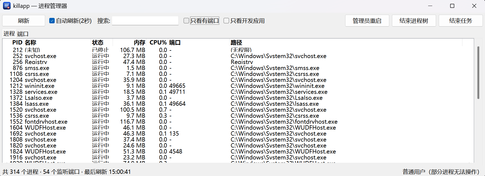
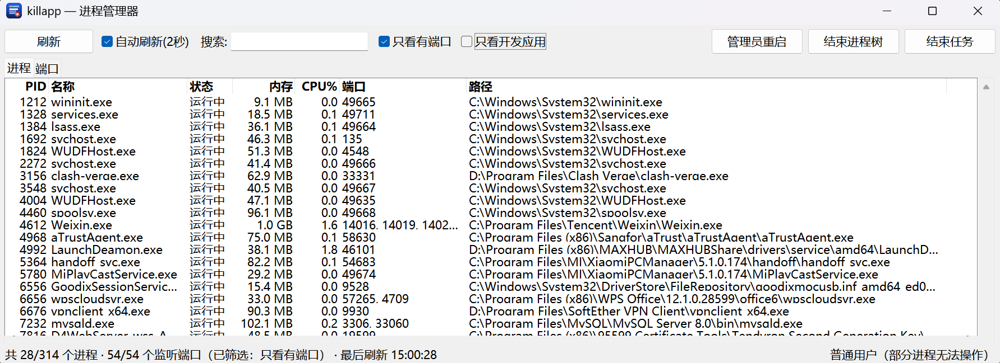
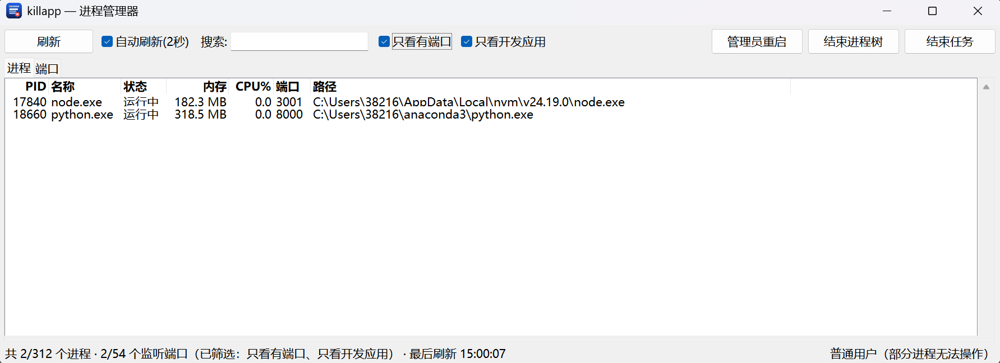

<div align="center">
  
  <h1>killapp</h1>
  <p><b>Windows 进程 / 端口查看器</b> —— 一个双击即开的迷你任务管理器</p>
  <p>
    
    
    
    
  </p>
</div>

---

不想为了看「谁占了 3000 端口」或者「哪个 node 进程吃内存」去开任务管理器？
`killapp` 把这件事做成一个 **11.5 MB 的单文件 exe**，双击就开，不装 Python，不弹黑框。

它同时也是原来的命令行工具 —— 脚本里用 `killapp list` / `killapp kill` 一样顺手。

## 特性

- **一键看全局**：PID、名称、状态、内存、CPU%、监听端口、可执行文件完整路径，一屏看完
- **端口反查**：端口页列出所有监听端口，双击就能结束占用它的进程
- **即时筛选**：搜索框实时过滤 + 两个复选框（只看有端口 / 只看 node、python、java）
- **一键排序**：点表头排序，内存和 CPU 按**数值**排（不是字符串）
- **结束进程**：单个结束 / 整棵进程树结束（子进程先死，不留孤儿）
- **按需提权**：普通权限启动，碰到权限不足才提示「以管理员身份重启」，不每次都弹 UAC
- **安全兜底**：内置关键系统进程白名单，拒绝结束自己，也会校验 PID 是否被复用
- **中文界面**：跟随 Windows 原生 `vista` 主题，125% / 150% / 175% 缩放下都不糊

## 截图

<details open>
<summary><b>全部进程</b></summary>



</details>

<details>
<summary><b>只看有端口的进程</b></summary>



</details>

<details>
<summary><b>只看有端口的 node / python / java</b></summary>



</details>

## 快速开始

### 直接下载

从 [Releases](https://github.com/shaojiang-ne/killapp/releases) 下载 `killapp.exe`，双击运行。
**不需要装 Python，不需要装任何依赖。**

### 从源码构建

需要 Python 3.8+：

```bash
git clone https://github.com/shaojiang-ne/killapp.git
cd killapp

# Windows 下双击 build.bat 也可以
python build.py
```

产物在 `dist\killapp.exe`。

> `build.py` 会先建一个干净的 `.venv` 再打包。如果你本机的默认 Python 是
> Anaconda，直接打包会把 numpy / pandas 一起拖进 exe，体积能到几百 MB —— 所以
> 这一步不能省。

### 跑源码

```bash
pip install -r requirements.txt

python killapp_gui.py    # 图形界面
python killapp.py list   # 命令行
```

## 使用说明

### 图形界面

| 操作 | 效果 |
|---|---|
| 点表头 | 按该列排序，再点一次反向；内存 / CPU 按数值排 |
| 搜索框 | 实时过滤进程名 / 路径 / 端口 / PID（150ms 去抖，只过滤缓存，不重新采集） |
| **只看有端口** | 进程页只显示有监听端口的进程 |
| **只看开发应用** | 只显示 node / python / java 进程（端口页同步过滤） |
| 右键 → 结束任务 | 结束选中的进程 |
| 右键 → 结束进程树 | 连同所有子进程一起结束（**子进程先死**） |
| 右键 → 复制 PID | 复制到剪贴板（用 `clip.exe`，关掉程序也不会丢） |
| 右键 → 打开文件位置 | 在资源管理器中定位到该 exe |
| 双击端口行 | 结束占用该端口的进程 |
| 管理员重启 | 以管理员身份重启本程序（仅在权限不足时需要） |

状态栏会显示当前看到的数量、总数和生效的筛选条件，勾选筛选后不会让你误以为
进程凭空消失了：

```
共 28/314 个进程 · 54/54 个监听端口（已筛选：只看有端口） · 最后刷新 15:00:28
```

### 命令行

原来的 CLI 一个字没改：

```bash
python killapp.py list              # 列出所有用户进程
python killapp.py ls                # 只列出 node/python/java/go 进程
python killapp.py ports             # 列出所有监听端口
python killapp.py search <关键词>   # 搜索进程或端口
python killapp.py kill <PID|名称>   # 结束进程
```

```
$ python killapp.py ls
PID      名称                     状态         内存         端口
-------- ------------------------ ------------ ------------ --------------------
3124     node.exe                 running      223.7 MB
4812     node.exe                 running      153.4 MB
6556     GoodixSessionService.exe running      15.1 MB      9528
12948    winlogon.exe             running      50.7 MB
17432    node.exe                 running      149.3 MB     4173
17840    node.exe                 running      180.2 MB     3001
```

结束进程：

```
$ python killapp.py kill 17840
已结束进程 17840 (node.exe)
```

表头和内容是按**显示宽度**对齐的（中文在终端里占两列），过长的进程名会被截断
成 `名字…`，不会把后面的列顶歪。

## 为什么这么快

最初用 psutil 采集，每次刷新要 **2.1 ~ 4.7 秒**，界面基本卡死。基准测试拆开看：

| 调用 | 317 个进程耗时 |
|---|---|
| `proc.status()` | 1.47 s |
| `proc.memory_info()` | 0.78 s |
| `proc.create_time()` | 0.73 s |
| `proc.name()` / `proc.exe()` | 0.008 s（psutil 内部有缓存） |
| 裸 `OpenProcess` × 316 | 0.001 s |

结论：**不是系统调用慢，是 psutil 每次调用都重新打开进程句柄**。

所以 `winproc.py` 直接走 Win32 API，一个进程只开一次句柄，复用它取时间 /
内存 / 路径：

```
OpenProcess → GetProcessTimes / GetProcessMemoryInfo
            → GetExitCodeProcess / QueryFullProcessImageNameW
```

结果：317 个进程的快速扫描 **0.005 秒**，比原来快约 400 倍。与 psutil 逐项
交叉校验 148 个可访问进程，**内存 / 创建时间 / 路径 / CPU 全部零误差**。

打不开句柄的约 170 个系统进程（`smss`、`csrss`、`wininit`…）走 psutil 慢路径，
**分批在后台跑**（每轮 12 个），界面完全不阻塞。

更细的实现说明见 [`docs/superpowers/specs/2026-10-26-killapp-gui-design.md`](docs/superpowers/specs/2026-10-26-killapp-gui-design.md)。

## 项目结构

```
killapp/
├── killapp.py        # CLI 入口
├── killapp_gui.py    # GUI 入口（PyInstaller entry point）
├── gui.py            # tkinter 界面
├── core.py           # 数据层 + 展示层（CLI 与 GUI 共用）
├── winproc.py        # Win32 快速进程采集
├── winadmin.py       # UAC 提权
├── build.py          # 构建脚本
├── build.bat         # 双击构建
├── assets/           # 图标
├── tools/
│   └── make_icon.py  # 图标生成脚本
└── docs/             # 设计文档 + 截图
```

## 环境要求

| | |
|---|---|
| 操作系统 | Windows 10 / 11 |
| 运行时依赖 | 无（打包后的 exe 不需要 Python） |
| 开发依赖 | Python 3.8+、`psutil >= 5.9.0`、`pyinstaller >= 6.6` |
| GUI 工具包 | tkinter（Python 标准库，无需额外安装） |

## 常见问题

**Q：有些进程的内存显示 0 B，路径显示「(无权限)」？**
A：普通用户打不开那些系统进程的句柄。点工具栏的「**管理员重启**」以管理员身份
运行就能看到完整数据 —— 但即使提权，`smss`、`csrss` 这些还是拿不到，这是
Windows 的保护机制，不是 bug。

**Q：端口页是空的？**
A：多半是权限不足导致 `net_connections()` 拿不到结果。同样用「管理员重启」。

**Q：为什么 CPU% 全是 0.0？**
A：CPU 百分比需要两次采样才能算出来。第一次刷新只有基线，第二次开始才有值。

**Q：结束进程会不会把系统搞崩？**
A：本工具内置了关键系统进程白名单（`system`、`csrss`、`wininit`、`lsass`、
`smss`、`winlogon`…），这些一律拒绝结束。结束普通的应用进程是安全的，但结束
「看起来像系统进程」的东西仍然要当心 —— 比如某些杀毒软件的守护进程。

**Q：能结束自己吗？**
A：不能，程序会明确拒绝。

## 安全提示

结束进程可能导致**未保存的数据丢失**。请确认目标进程后再操作。

本工具只做两件事：读取系统进程信息、向 Windows 请求结束进程。它不修改注册表、
不注入进程、不联网上传任何东西。

## 参与贡献

欢迎提交 Issue 和 Pull Request。

```bash
git clone https://github.com/shaojiang-ne/killapp.git
cd killapp
python build.py --run    # 构建并启动
```

- 想改界面 → `gui.py`
- 想改进程采集 → `winproc.py`（注意保持和 psutil 的行为一致）
- 想改 CLI → `core.py` 的展示层部分
- 改动后请跑一遍 `python killapp.py list / ls / ports / search / kill` 做回归

## License

[MIT](LICENSE) © 2026 Neo

---

<div align="center">
  <sub>用 ❤️ 和 tkinter 做的</sub>
</div>
